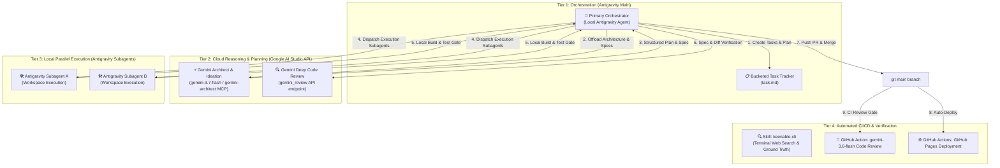

# Antigravity Multi-Agent Architecture v3.0.0 (Gemini AI Studio API + Local Antigravity)

> **Context**: Architectural specification for autonomous multi-agent development relying exclusively on Google AI Studio Gemini API endpoints ($\ge 3.5$) and local Antigravity orchestration. Google Jules has been completely decommissioned and superseded by this pipeline.

---

## System Architecture

---

## Key Rules & Directives

### 1. Model Quota Hierarchy & Execution Tiers
1. **Google AI Studio Gemini API ($\ge 3.5$ Only):** Offload high-reasoning tasks, system architecture design, trade-off analysis, and deep code reviews (`gemini-3.7-flash`, `gemini_architect`, `gemini_review`).
2. **Local Antigravity Subagents:** Primary code generator and test executor, running in isolated workspace branches/worktrees.
3. **Primary Antigravity Orchestrator:** High-level supervisor, bucket tracker, gatekeeper, and merge controller.

### 2. Zero External Cloud Sandbox Dependency
- All code generation, testing, and file operations happen directly in the local repository under Antigravity.
- No reliance on third-party cloud sandbox services or deprecated Jules sessions.

### 3. Antigravity Quality Gate Review
- Before merging any branch or subagent changes, the Orchestrator MUST:
  1. Inspect the git unidiff for regression risks or unwanted artifacts.
  2. Run local automated tests (`pytest`, `npm test`, or syntax linters).
  3. Validate architectural compatibility and formatting standards.
